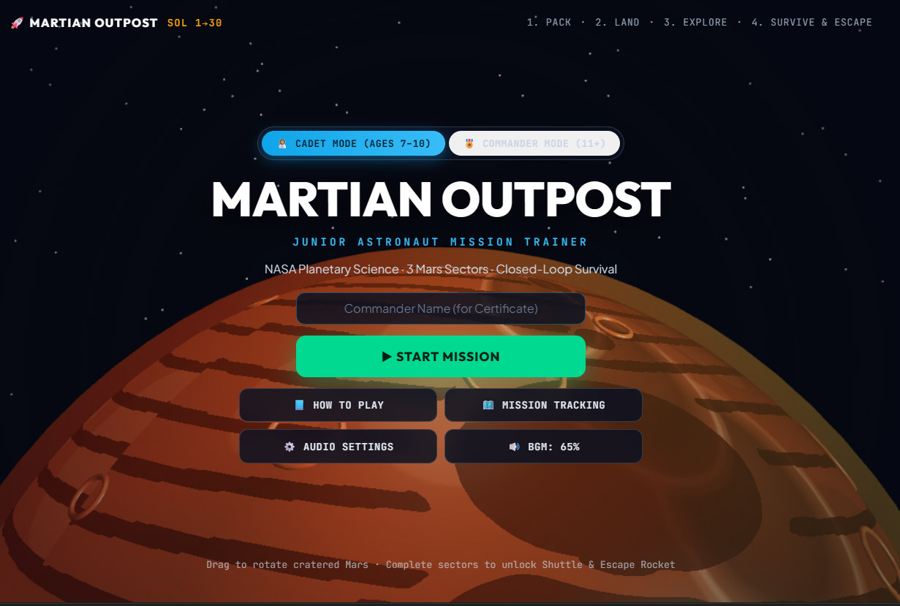

# Martian Outpost

**Junior Martian Outpost Commander** is a browser-based 3D game about keeping a Mars outpost running with limited supplies. Pack a lander, make a safe landing, complete tasks across three Martian sectors, and prepare the crew for escape.

Built for the **Build an Astronaut Mission Trainer** challenge at NASA Space Apps.

**[Play the game](https://teamcgi.vercel.app/)**



## Why we built it

Knowing that astronauts need oxygen, water, and electricity is one thing. Deciding how much to carry, and what to prioritise when supplies run low, is another.

Martian Outpost gives students those decisions. More shielding leaves less cargo space for other supplies. Greenhouse production needs resources that other systems also use. A delayed delivery forces players to reconsider their priorities.

The goal is to help young learners understand how the systems supporting a mission depend on each other. The final debrief lets players review their choices and consider what they would change on another attempt.

## The mission

1. **Pack the lander.** Divide a maximum payload of 1,200 kg between oxygen and water reserves, solar power cells, and radiation shielding.
2. **Travel and land.** Follow the Earth-to-Mars transit sequence, then control the lander's descent onto the landing pad.
3. **Operate the outpost.** Explore each sector, talk to mission characters, and complete tasks to unlock the next location.
4. **Respond to emergencies.** Handle delayed resupply, make a solar-storm decision, and balance safety against power use and science objectives.
5. **Prepare for escape.** Produce propellant, reach the escape rocket, and review the mission debrief. A downloadable in-game completion certificate is available at the end.

| Sector | Main tasks |
| --- | --- |
| **Jezero Crater** | Restore solar arrays, manage the greenhouse, balance habitat oxygen, and seal the airlock. |
| **Valles Marineris** | Deploy seismometers, drill for ice, tune the canyon radio, manage delayed supplies, and complete the asteroid-defence challenge. |
| **Olympus Foothills** | Configure sensors and communications, align cooling pipes, produce rocket propellant, and survive the final storm and escape sequence. |

### Difficulty modes

- **Cadet, ages 7–10:** More forgiving challenge settings.
- **Commander, ages 11+:** Tighter solar-panel alignment tolerance, a narrower ice-drilling timing window, and more demanding flight and defence settings.

Several puzzle layouts and targets vary between attempts. Follow the instructions shown in each task, including the fuel reactor's temperature target.

## Controls

| Control | Action |
| --- | --- |
| `W`, `A`, `S`, `D` or arrow keys | Move on the surface; steer during landing and flight. |
| `Space` | Jump during exploration; hold to brake during landing. |
| `E` | Interact with nearby characters, equipment, or a shuttle. |
| Mouse drag | Rotate the camera. |
| Mouse click | Use puzzle controls, select decisions, and target asteroids during defence. |

Use **How to Play** for a quick briefing and **Mission Tracking** to check tasks and unlocks. The desktop keyboard and mouse controls are the primary way to play.

## NASA data and science

The game requests recent event records from [NASA DONKI](https://ccmc.gsfc.nasa.gov/tools/DONKI/) through the [NASA Open APIs](https://api.nasa.gov/):

| Endpoint | Information used |
| --- | --- |
| `CMEAnalysis` | Coronal mass ejection analysis, including reported speed. |
| `notifications` | Space-weather notices and available flare-class references. |
| `GST` | Geomagnetic storm records and Kp values. |
| `SEP` | Solar energetic particle event records. |

The current implementation requests a 21-day window and uses the results to inform a simplified storm scenario. It can run a training drill when requests fail or conditions are calm.

The dashboard combines retrieved records with defaults and game-derived estimates, including its proton-flux display. These values are gameplay context, not measurements of radiation at the player's location on Mars.

The in-game sources panel also references NASA's Open Science Data Repository and Mars missions such as Curiosity, Perseverance, and InSight. These are educational references, not additional live API integrations. The prototype does not currently document a dataset-by-dataset mapping for its OSDR references.

The fuel task introduces **in-situ resource utilization (ISRU)**: using resources available at the destination to make useful supplies. Players configure a simplified process for methane and liquid oxygen propellant production.

The cargo limit, resource changes, radiation effects, travel times, and scoring are game rules. Martian Outpost is an educational prototype, not a validated mission simulator or an official NASA training product.

## Technology

| Tool | Role |
| --- | --- |
| HTML, CSS, and JavaScript | Interface, game state, resource management, puzzles, and mission progression. |
| Babylon.js / WebGL | 3D scenes, models, camera, and rendering. |
| Vite | Development server and production build. |
| React, TypeScript, and Tailwind CSS | Supporting project scaffolding and build configuration. |
| NASA DONKI API | Space-weather event inputs. |
| Vercel | Hosting for the playable website. |
| GitHub | Source code and version history. |

The current game interface and logic live primarily in `index.html`. The React components in `src/` are minimal scaffolding.

## Run locally

### Requirements

- Node.js 22.12 or newer in the 22.x release line, or a newer supported LTS release. See [Vite's requirements](https://vite.dev/guide/).
- npm and Git.
- A browser with WebGL support, plus a keyboard and mouse.
- Internet access for external resources, including the Babylon.js CDN and NASA API requests.

```bash
git clone https://github.com/Muhammad-Khizer-Wajid/ares-outpost.git
cd ares-outpost
npm install
npm run dev
```

Open [http://localhost:3000](http://localhost:3000), or the address printed by Vite if that port is already in use.

### Available commands

| Command | Purpose |
| --- | --- |
| `npm run dev` | Start the development server on port 3000. |
| `npm run build` | Create the production build in `dist/`. |
| `npm run preview` | Serve the production build locally after building. |
| `npm run lint` | Run `tsc --noEmit` to check the TypeScript files. |

The `lint` command is a TypeScript check. It does not test the gameplay code embedded in `index.html`.

### API configuration

The current prototype reads its DONKI key from the `NASA_DONKI_API_KEY` constant in `index.html`. For a separate deployment, obtain your own key from [NASA Open APIs](https://api.nasa.gov/) and update that configuration. This is client-side configuration, so the key is visible in the delivered page.

The `GEMINI_API_KEY` and `APP_URL` entries in `.env.example` belong to the project scaffolding. They are not required by the current game logic, and the DONKI configuration does not read them.

The storm fallback handles unavailable NASA data; it does not make the whole application work offline. The 3D engine still loads from an external CDN.

## Repository layout

| Path | Contents |
| --- | --- |
| `index.html` | Main interface, styles, Babylon.js scene, game logic, and NASA requests. |
| `public/assets/aistudio/` | Project screenshots and reference material. |
| `src/` | Minimal React and TypeScript scaffolding. |
| `package.json` | Dependencies and development commands. |
| `vite.config.ts` | Vite plugins and development configuration. |
| `tsconfig.json` | TypeScript configuration. |
| `.env.example` | Example variables from the project scaffolding. |

## Educational goals and next steps

The game is designed to give students practice in resource budgeting, identifying system dependencies, and explaining decisions under uncertainty. Science points and completion scores describe game performance; they are not a measurement of learning gains.

Potential next steps include student and teacher testing, clearer source attribution for each scientific mechanic, improved accessibility and mobile controls, and splitting the main game into smaller modules. A short assessment before and after play could help evaluate what students learn.

## Credits

- NASA DONKI and the Community Coordinated Modeling Center for space-weather information.
- NASA mission and open-science resources referenced in the game's sources panel.
- Babylon.js and the other dependencies listed in `package.json`.
- The Mars reference image `public/assets/aistudio/image_83b86e0c.png` carries the credit **ESA/DLR/FU Berlin, CC BY-SA 3.0 IGO**.

Third-party resources retain their original credits and terms. This README does not assign a project-wide software licence.
